# 🎓 BARATONHUB
### One Campus. One Connected Experience.

**Transforming the University of Eastern Africa, Baraton into a smarter, more connected, and intelligent digital campus.**

<p align="center">

  **ISC DIGITAL BUILD-OFF 2026 | ADONISTEAM**

  [🌐 LIVE DEMO](https://baratonhub.vercel.app) · [💻 GITHUB REPOSITORY](https://github.com/Adonis255/ISC-Digital-Build-Off-2026-AdonisTeam)

  ---

## 🔐 Accounts for Judges

To test the platform, please use the following pre-configured accounts. 

**Admin Account (Full Access)**
*   **URL:** `https://baratonhub.vercel.app/login` 
*   **Email:** `admin@ueab.ac.ke`
*   **Password:** `AdminPassword2026!`

**Student Account**
*   **URL:** `https://baratonhub.vercel.app/login`
*   **Email:** `soguom2411@ueab.ac.ke`
*   **Password:** `#Snake038`

**Lecturer Account**
*   **URL:** `https://baratonhub.vercel.app/login`
*   **Email:** `felixkiptoo@ueab.ac.ke`
*   **Password:** `Password123!`

**Worker Account**
*   **URL:** `https://baratonhub.vercel.app/login`
*   **Email:** `mercykibet@ueab.ac.ke`
*   **Password:** `Password123!`

*(Note: Students can create accounts on their own as long as they the ueab student email.. but lectures are created by the admin).*

</p>

---

## 🌍 THE VISION

What if an entire university could operate through one connected digital ecosystem?

Imagine students receiving important announcements instantly, lecturers managing attendance without interrupting lectures, administrators monitoring campus activities, and students receiving early support before academic challenges become failures.

Imagine a student being rewarded for helping another student, participating in campus activities, and contributing positively to the university community.

That is the vision behind **BaratonHub**.

University life should not be fragmented across physical notice boards, disconnected communication channels, manual registers, and administrative queues.

We believe technology can make campus life more accessible, efficient, collaborative, and intelligent.

**BaratonHub is a unified, role-based digital campus ecosystem designed to connect students, lecturers, administrators, and university workers through one platform.**

Our mission:

> One university. One digital ecosystem. A better campus experience for everyone.

---

# 🚨 1. THE PROBLEM WE ARE SOLVING

University campuses often operate through disconnected communication channels and manual administrative processes.

At the University of Eastern Africa, Baraton, we identified several challenges affecting everyday campus experiences.

| Campus Challenge | Existing Problem | Our Solution |
|:---|:---|:---|
| Lost Belongings | No centralized lost-and-found platform | Digital Lost & Found |
| Campus Announcements | Students miss physical notice-board updates | Interactive Digital Notice Board |
| Lecture Attendance | Manual registers consume lecture time | Smart GPS Attendance |
| Fee Management | Delayed access to financial information | Digital Fee Management |
| Examination Seating | Manual allocation is time-consuming | Automated Exam Seating |
| Campus Information | Students struggle to locate offices and services | Campus Directory |
| Student Welfare | Accessing confidential support can be difficult | Counselling Requests |
| Academic Performance | Students at risk may not receive early intervention | Student Success Intelligence |
| Student Engagement | Positive campus contributions are difficult to recognize | Baraton Rewards |

We believe these are not isolated problems. They are symptoms of a campus that needs better digital connectivity.

## Our User Research

We conducted preliminary interviews with **six students and one lecturer** to understand the challenges experienced by different members of the university community.

The research included students from different academic years and programmes.

### What students told us

**John Kimani – Third Year, Nursing**

"I lost my student ID last semester. I asked around and checked the library, but there was no central place to check if someone had found it."

He also highlighted difficulties with fee-payment updates, particularly when delayed reflection affected examination clearance.

**Alvin Otieno – Fourth Year, BBIT**

"Last semester I missed exams due to the system not updating the fee payments on time."

He also highlighted how students miss scholarship and internship opportunities because announcements are scattered across different channels.

**Ian Esilan – First Year, Education**

"I do not know where some offices are allocated in the school."

He also highlighted the difficulty new students face when trying to discover student groups and access information scattered across different platforms.

### What the lecturer told us

"Taking attendance manually takes 10 minutes of my lecture time. I need a faster, secure way to know who is actually in the room, not just who has a friend in class."

### Research takeaway

Our preliminary research revealed recurring needs around:

- Centralized campus communication.
- Faster administrative processes.
- Improved student accessibility.
- Better attendance accountability.
- Easier access to university services.
- Earlier academic support.

These findings informed the design of BaratonHub.

---

# 💡 2. INTRODUCING BARATONHUB

BaratonHub brings essential university interactions into one application.

Rather than building separate solutions for individual campus problems, we designed a connected ecosystem with dedicated interfaces and permissions for different stakeholders.

## Four Connected User Experiences

| User Role | Platform Experience |
|:---|:---|
| 🎓 Student | Academic information, attendance, fees, examinations, notices, rewards, lost and found, and campus services |
| 👨‍🏫 Lecturer | Lecture management, attendance sessions, student interaction, academic monitoring, and student performance insights |
| 🛡️ Administrator | Campus oversight, user management, financial administration, analytics, and institutional operations |
| 👷 Worker | Relevant campus information, assigned services, and dedicated operational access |

Every user receives an experience designed around their responsibilities.

---

# ⚡ 3. THE CORE FEATURES

## 📍 A. SMART LECTURE & GPS ATTENDANCE

**Making lecture attendance faster, smarter, and more accountable.**

Traditional attendance registers are vulnerable to errors, consume valuable lecture time, and make proxy attendance possible.

BaratonHub introduces a location-aware attendance workflow.

### How it works

1. A lecturer selects a class and initiates a lecture session.
2. The lecturer enters the lecture topic and relevant session information.
3. The system activates the attendance session.
4. Students access the active session through their accounts.
5. The system checks their geographical location against the configured 300-metre attendance radius.
6. Attendance is recorded and reflected in the lecturer's live session view.

### Additional capabilities

- Live attendance monitoring.
- GPS distance verification.
- Device-based checks to discourage duplicate or proxy attendance.
- Interactive in-class Q&A.
- Lecture session management.
- Attendance records and tracking.

**Our objective:** Reduce administrative workload while improving attendance accountability.

## 📢 B. INTERACTIVE DIGITAL NOTICE BOARD

**Campus information should reach students, not wait for students to find it.**

BaratonHub introduces a centralized digital communication space that brings campus announcements and community interactions together.

### Features

- Campus-wide announcements.
- Student and staff posts.
- Internship and scholarship opportunities.
- Event announcements.
- Image uploads.
- Urgency classifications.
- Expiry dates for time-sensitive notices.
- Authenticated community posting.
- Centralized campus information feed.

This transforms the traditional notice board into an interactive digital campus communication platform.

## 🔎 C. SMART LOST & FOUND

**A lost item shouldn't automatically become a permanently lost item.**

Our Lost & Found module gives students and campus stakeholders a centralized place to report missing belongings and help reunite owners with their property.

### Features

- Report lost belongings.
- Report found items.
- Upload item photographs.
- Describe where and when an item was found.
- Submit private ownership claims.
- Administrative review of ownership claims.

The goal is to create a more accountable and helpful campus community.

## 💰 D. DYNAMIC FEE MANAGEMENT

**Making financial information easier to access.**

Students need convenient access to their financial information without unnecessary administrative delays.

BaratonHub introduces:

- Course-based fee calculations.
- Student fee balances.
- Payment records.
- Visual financial progress indicators.
- Examination clearance tracking.
- Mock payment functionality for demonstration.

The platform demonstrates how financial information can be presented in a clear and accessible format.

**Payment status:** The current payment workflow is simulated. Live Safaricom M-Pesa Daraja integration is planned.

## 📝 E. EXAMINATION & AUTOMATED SEATING

Managing examination seating manually can become complicated when multiple courses, students, and examination rooms are involved.

BaratonHub introduces:

- Bulk examination data uploads through CSV.
- Examination management.
- Student-course enrollment references.
- Automated seating allocation.
- Room-capacity constraints.

Our objective is to simplify examination preparation and reduce manual allocation errors.

## 🏢 F. CAMPUS DIRECTORY & COUNSELLING

A university is more than classrooms and lecture halls.

Students need convenient access to administrative offices, university services, and welfare support.

Our platform includes:

- Searchable campus directory.
- Office information and photographs.
- Access to relevant campus services.
- Confidential counselling request functionality.

This is particularly valuable for new students who are still learning how to navigate the university.

---

# 🧠 4. THE INTELLIGENCE LAYER — THE FUTURE OF SMARTER CAMPUS MANAGEMENT

We envision BaratonHub becoming more than a campus management platform.

Our next innovation is introducing intelligent systems that help universities understand student needs, identify potential challenges, and improve student engagement.

## A. Student Success Intelligence

**Identify academic risk before it becomes academic failure.**

One of the most important opportunities in university technology is moving from reacting to academic failure to identifying warning signs early.

We envision a machine-learning-powered Student Success Intelligence module that analyzes relevant academic indicators to identify students who may need additional support.

### How the proposed system works

The model would analyze authorized academic indicators such as:

- Historical examination performance.
- Continuous assessment trends.
- Attendance patterns.
- Assignment submission patterns.
- Course performance.
- Changes in academic engagement.

### Machine Learning Workflow

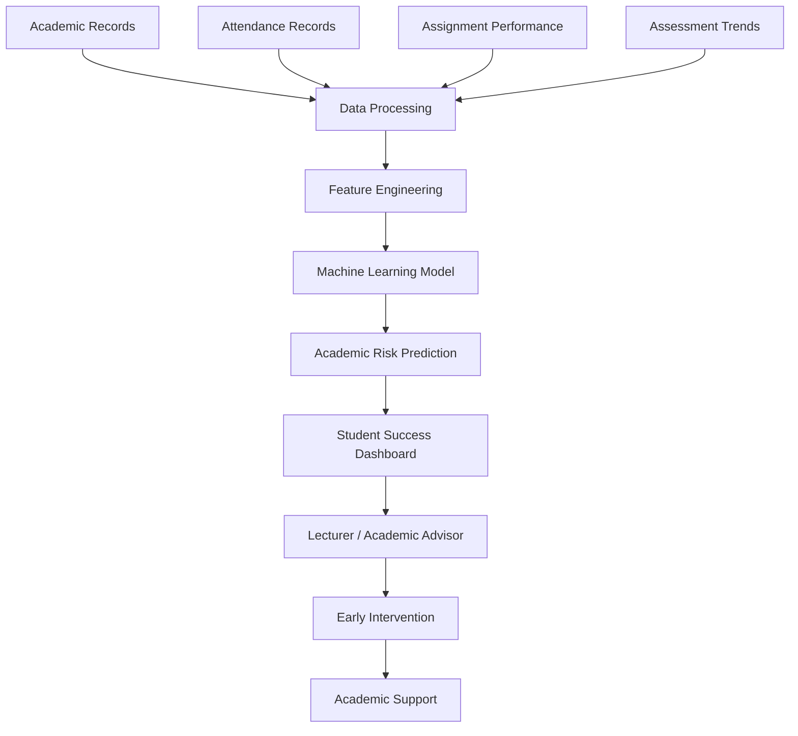

### Proposed machine learning models

| Model | Potential Application |
|:---|:---|
| Logistic Regression | Predict the probability of a student experiencing academic difficulty |
| Random Forest | Identify complex relationships between attendance, assessment, and academic outcomes |
| XGBoost | Improve predictive performance on structured academic datasets |
| K-Means Clustering | Identify groups of students with similar academic performance patterns |

### Student Risk Classification

The proposed system could classify students into:

- **Low Risk:** Academic performance appears stable.
- **Moderate Risk:** Emerging patterns require monitoring.
- **High Risk:** Significant indicators suggest that academic intervention may be necessary.

### The intervention process

1. The system identifies potentially concerning academic patterns.
2. The lecturer or authorized academic advisor receives an alert.
3. The student's academic progress is reviewed.
4. Appropriate academic support is recommended.
5. Progress is monitored over time.

**Important:** These predictions would be decision-support indicators, not final judgments about students. Academic staff would review alerts before taking action. Students would not be automatically penalized or denied opportunities based on a prediction.

This feature is proposed for a future development phase and requires suitable historical data, validation, and institutional approval.

## B. BARATON REWARDS — GAMIFYING CAMPUS PARTICIPATION

**Make positive campus participation visible and rewarding.**

We believe a university should recognize more than examination results.

Students contribute to campus life in many ways: helping classmates, participating in events, engaging in academic activities, and supporting their communities.

Baraton Rewards is our proposed gamification system designed to encourage these positive contributions.

### How the rewards ecosystem could work

Students earn points for verified activities and positive contributions.

| Activity | Proposed Reward |
|:---|:---|
| Helping another student | Community Points |
| Participating in university events | Engagement Points |
| Attending academic activities | Academic Engagement Points |
| Contributing useful campus information | Community Contribution Points |
| Participating in approved clubs | Campus Participation Points |
| Volunteering in campus initiatives | Service Points |

### Rewards & Recognition

The proposed system includes:

- Student points and achievement history.
- Digital badges.
- Achievement levels.
- Campus leaderboards.
- Recognition for outstanding contributions.
- Monthly student recognition.
- Community participation milestones.

### Example Achievement Badges

- 🏆 Campus Champion
- 📚 Academic Achiever
- 🤝 Community Helper
- 🌟 Active Student
- 💡 Innovation Contributor
- ❤️ Campus Volunteer

### Why it matters

Baraton Rewards aims to:

1. Encourage positive student participation.
2. Build stronger campus communities.
3. Recognize contributions beyond academics.
4. Encourage collaboration between students.
5. Make campus life more engaging.

Rewards would be based on verified activities, with safeguards against fake participation and leaderboard manipulation.

**Development status:** Proposed future module.

---

# 🌐 5. ADDITIONAL INNOVATION OPPORTUNITIES

Beyond the existing modules and proposed intelligence layer, BaratonHub provides a foundation for further digital transformation.

| Innovation | Potential Value |
|:---|:---|
| AI Campus Assistant | Help students navigate campus services and find relevant information |
| Smart Notifications | Deliver timely reminders about examinations, announcements, and opportunities |
| Academic Progress Tracking | Give students a clearer picture of their academic development |
| Student Communities | Connect students through academic groups, interests, and activities |
| Smart Event Discovery | Help students discover campus activities and events |
| Digital Student Engagement | Encourage participation in university activities |
| Advanced Analytics | Help administrators identify operational patterns and opportunities for improvement |

Our long-term vision is to create a campus where information, services, and opportunities are interconnected.

---

# 🖥️ 6. SYSTEM ARCHITECTURE

BaratonHub is built as a modern web application supported by a centralized backend and relational database.

## Technology Stack

| Layer | Technology |
|:---|:---|
| Frontend | React 18 |
| Build Tool | Vite |
| Styling | Tailwind CSS |
| Navigation | React Router |
| Icons | Lucide |
| Backend | Supabase |
| Database | PostgreSQL |
| Authentication | Supabase Auth |
| File Storage | Supabase Storage |
| Real-time Services | Supabase Realtime |
| Hosting | Vercel |
| Version Control | Git & GitHub |
| Location Services | HTML5 Geolocation API |

## System Architecture

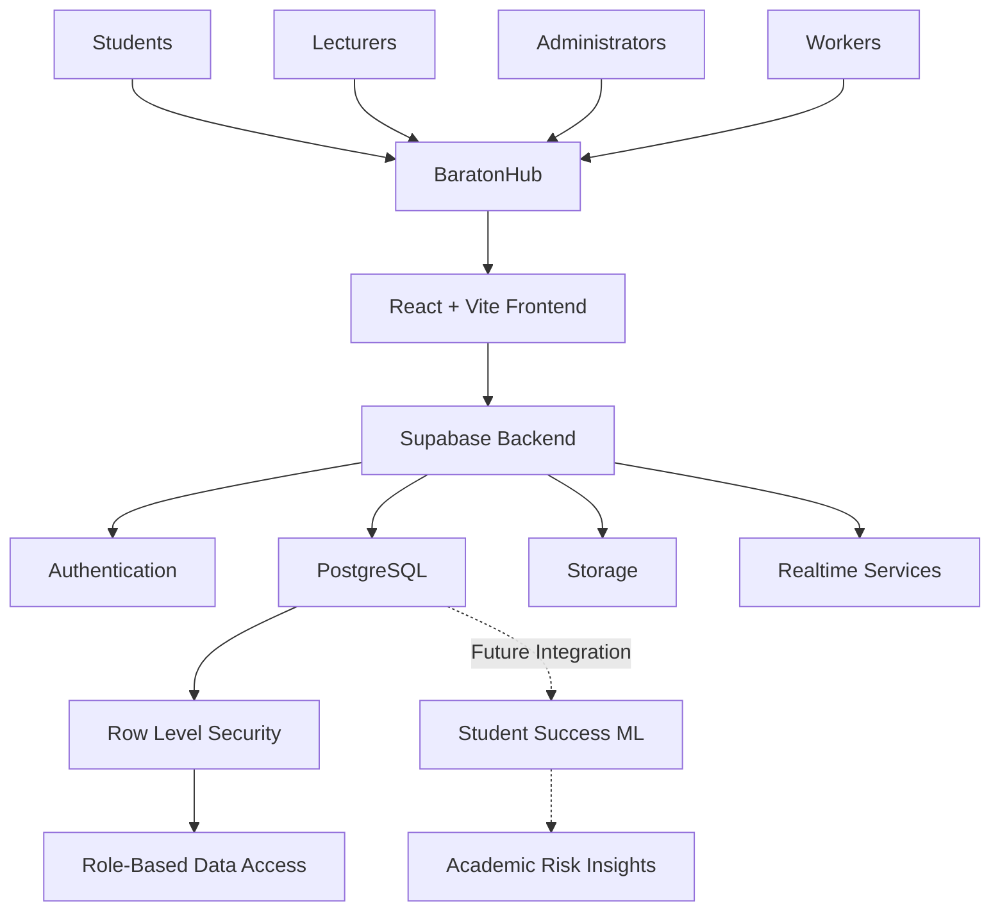

## Database Architecture

We use PostgreSQL through Supabase to organize the platform's data into interconnected modules.

Our database design covers:

- Core user and role management.
- Academic records.
- Courses and lecture sessions.
- Attendance management.
- Financial records.
- Examination management.
- Campus communication.
- Lost and found.
- Student support services.

The database uses Row Level Security (RLS) policies to enforce data access restrictions at the database level.

### Database Entity Relationship Diagrams

The following diagrams illustrate the database structure:

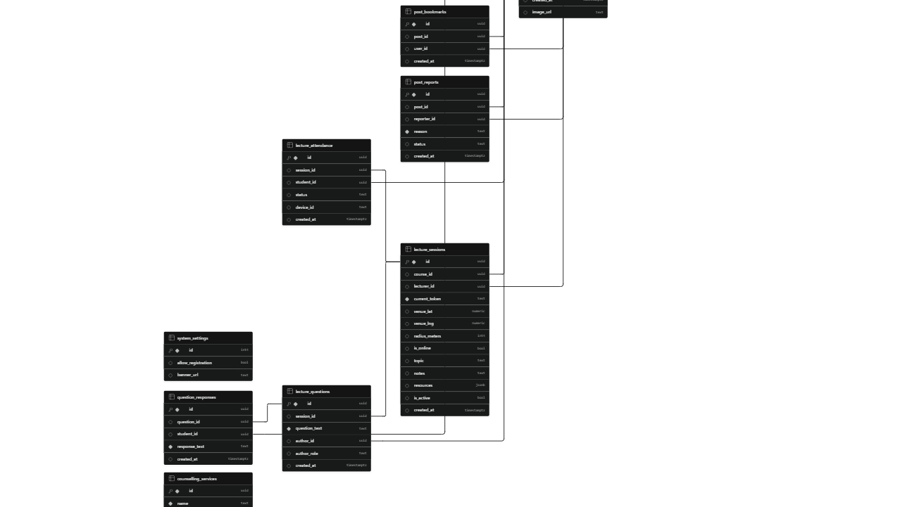

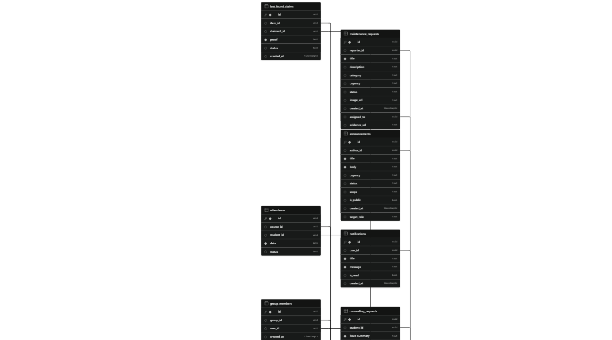

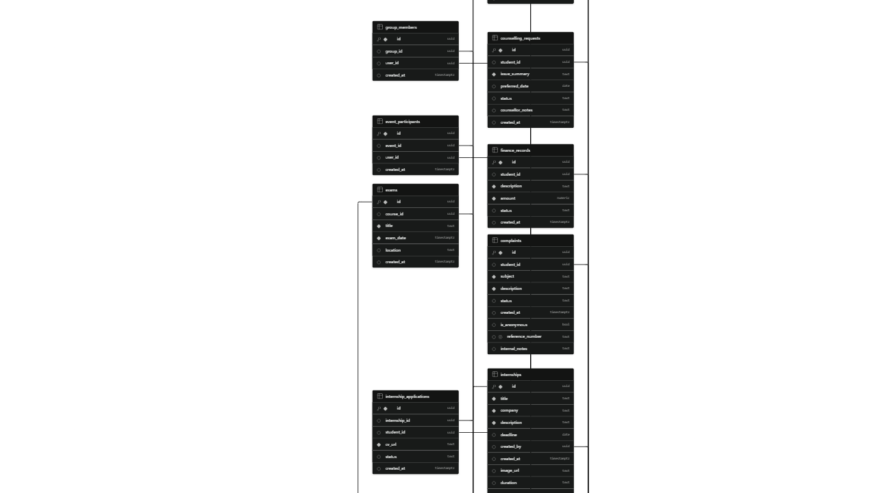

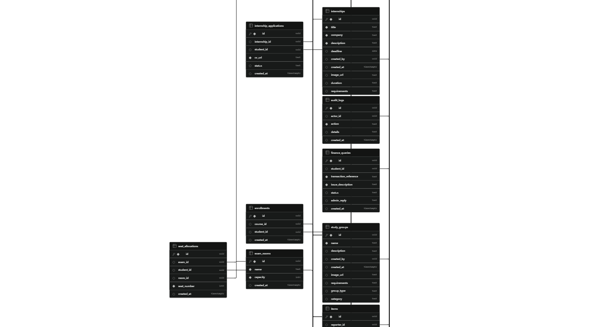

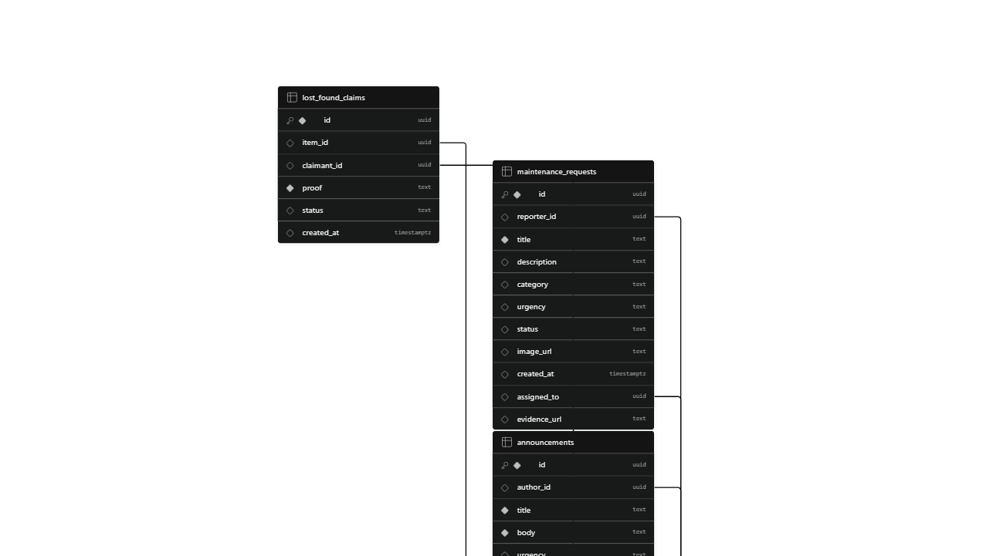

---

# 🔐 7. SECURITY & DATA PROTECTION

A university platform handles sensitive academic, financial, and personal information. Security is therefore a core design consideration.

BaratonHub incorporates:

- Supabase authentication.
- Role-based access control.
- PostgreSQL Row Level Security.
- Restricted access to student-specific records.
- Protected administrative functionality.
- Environment-based configuration for application credentials.
- Controlled access to sensitive student information.

## Security Testing

Our development testing included:

- Attempting to access administrative dashboards using student accounts.
- Testing whether students could modify their assigned roles.
- Attempting to access another student's financial records.
- Testing unauthorized access to attendance information.

These tests helped us validate important access-control boundaries.

---

# 📸 8. EXPERIENCE BARATONHUB — PLATFORM SHOWCASE

Explore six major interfaces that demonstrate how BaratonHub connects different campus experiences.

### 01. Administrative Dashboard

Centralized campus oversight, administration, and analytics.

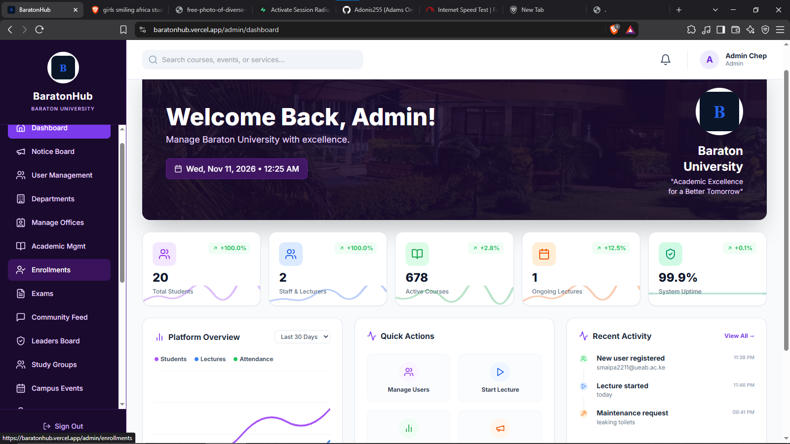

### 02. Student Dashboard

A centralized student experience for academic information, campus activities, and essential services.

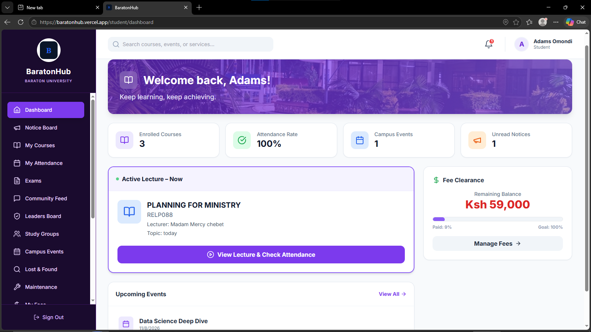

### 03. Lecturer Dashboard & Smart Attendance

Manage lecture sessions, monitor attendance, and interact with students.

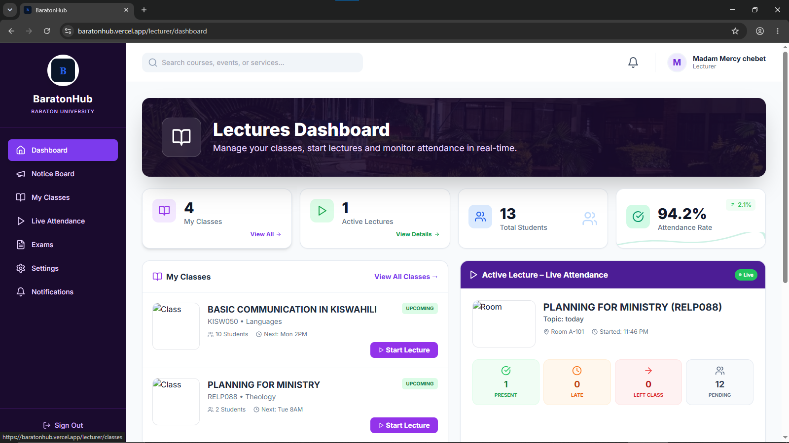


### 04. Digital Notice Board

A centralized interactive feed for campus announcements, opportunities, and community posts.

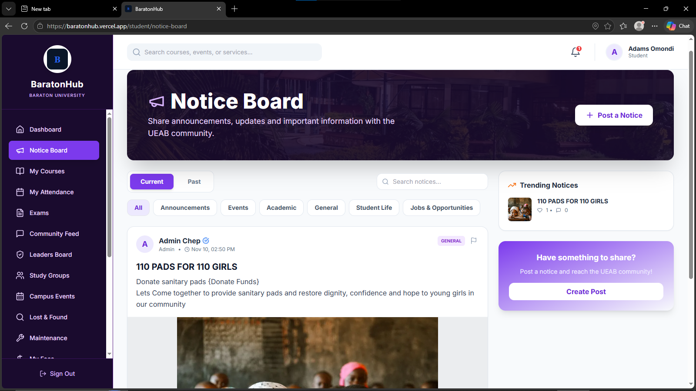

### 05. Student Fee Management

Access financial information, payment records, and examination clearance progress.


### 06. Smart Lecture Live Session

A location-aware lecture experience with live attendance monitoring and student interaction.


---

# 🚀 9. LIVE DEMONSTRATION

**Experience BaratonHub:**

🌐 https://baratonhub.vercel.app

💻 https://github.com/Adonis255/ISC-Digital-Build-Off-2026-AdonisTeam

We encourage judges to explore the different role-based interfaces and experience how the modules work together.

---

# ⚙️ 10. RUN BARATONHUB LOCALLY

## Prerequisites

- Node.js v18 or later.
- npm.
- A Supabase project.
- Git.

### Step 1: Clone the Repository

```bash
git clone https://github.com/Adonis255/ISC-Digital-Build-Off-2026-AdonisTeam.git

cd ISC-Digital-Build-Off-2026-AdonisTeam
```

### Step 2: Install Dependencies

```bash
npm install
```

### Step 3: Configure Environment Variables

Create a `.env` file in the project root.

Add your Supabase project credentials:

```env
VITE_SUPABASE_URL=your_supabase_project_url
VITE_SUPABASE_ANON_KEY=your_supabase_anon_key
```

Never expose your Supabase service-role key in frontend code.

### Step 4: Configure the Database

1. Open your Supabase project.
2. Navigate to the SQL Editor.
3. Locate the database scripts in the project's `/database` directory.
4. Execute the required schema and policy scripts.

### Step 5: Start the Development Server

```bash
npm run dev
```

Open the local URL displayed in your terminal.

---

# 📊 11. BUSINESS MODEL & SUSTAINABILITY

BaratonHub is designed to be scalable and sustainable beyond the competition.

## Value Proposition

| Stakeholder | Value Delivered |
|:---|:---|
| Students | Convenient access to essential campus services |
| Lecturers | Reduced manual attendance administration |
| Administrators | Centralized campus management |
| University | Improved digital communication and operational efficiency |

## Sustainability Strategy

Our initial deployment approach uses affordable cloud infrastructure and free-tier services where possible.

Potential long-term sustainability approaches include:

- Institutional licensing.
- Annual software maintenance agreements.
- Premium integrations.
- Scalable cloud infrastructure.
- Custom institutional modules.

## Adoption Strategy

We propose introducing BaratonHub through:

1. A controlled university pilot.
2. Student and lecturer onboarding.
3. Campus ambassadors.
4. Orientation and digital literacy programs.
5. Continuous feedback and improvements.

Our objective is to make BaratonHub a practical campus utility rather than another application students rarely use.

---

# 🧪 12. TESTING & USER FEEDBACK

We considered usability, accessibility, and system reliability throughout development.

### Mobile Responsiveness

- Tested the interface on different devices.
- Focused on responsive layouts and mobile navigation.
- Tested access to the digital notice board on mobile screens.

### User Feedback

- Conducted preliminary research involving six students and one lecturer.
- Identified the need for more accessible announcements.
- Identified the need for faster lecture attendance.
- Identified challenges involving fee-payment information and campus navigation.
- Incorporated these findings into the platform's feature design.

### Functional & Security Testing

- Tested role-based access restrictions.
- Tested student-specific data access.
- Tested administrative permissions.
- Tested the simulated fee payment workflow and its interface updates.

---

# 🛣️ 13. THE ROADMAP

We envision BaratonHub evolving through several development stages.

| Development Area | Planned Enhancement | Expected Impact |
|:---|:---|:---|
| Financial Technology | M-Pesa Daraja Integration | Real payment processing |
| Mobile Experience | Native Mobile Application | Push notifications and improved mobile access |
| Artificial Intelligence | AI Campus Assistant | Intelligent navigation of university services |
| Machine Learning | Student Success Intelligence | Earlier identification of academic risk |
| Gamification | Baraton Rewards | Increased student engagement |
| Academic Integration | Expanded Academic Systems | More comprehensive academic information |
| Analytics | Advanced Institutional Analytics | Better administrative decision-making |
| Attendance | Advanced Attendance Verification | Stronger session integrity |

Student Success Intelligence and Baraton Rewards are proposed enhancements requiring further development, testing, and institutional collaboration.

We also envision integrations with official university systems, subject to institutional approval and access to authorized data.

---

# 👥 14. MEET THE TEAM — ADONISTEAM

BaratonHub was developed by a team passionate about using technology to solve practical challenges in the university environment.

## Adams Omondi

**Team Leader | Full-Stack Developer | ISC Student**

Contributions:

- System architecture and overall development.
- Database design and PostgreSQL architecture.
- Supabase integration and RLS policies.
- GPS-based attendance implementation.
- Backend and frontend integration.
- Deployment and project coordination.

GitHub: [@Adonis255](https://github.com/Adonis255)

## Joan Cherono

**Frontend Developer | UI/UX Designer**

Contributions:

- User interface and experience design.
- Wireframes and visual design.
- Purple-themed interface implementation.
- Frontend development.
- User testing and usability improvements.

GitHub: [Insert Joan's GitHub Profile]

Registration Number: [Insert Joan's Registration Number]

---

# ❤️ 15. OUR COMMITMENT

We believe technology should solve real problems, improve everyday experiences, and create opportunities for people.

BaratonHub is our contribution toward a university where communication is more accessible, administration is more efficient, students receive better support, and campus communities become more connected.

We did not set out to build just another student portal.

We set out to rethink how an entire campus connects.

**Because the future of a university is not just about smarter classrooms. It is about a smarter, more connected campus.**

---

<p align="center">

# 🎓 BARATONHUB

### One Campus. One Connected Experience.

**Built with ❤️ by AdonisTeam**

ISC Digital Build-Off 2026  
University of Eastern Africa, Baraton

[🌐 EXPLORE BARATONHUB](https://baratonhub.vercel.app)

[💻 VIEW SOURCE CODE](https://github.com/Adonis255/ISC-Digital-Build-Off-2026-AdonisTeam)

</p>
